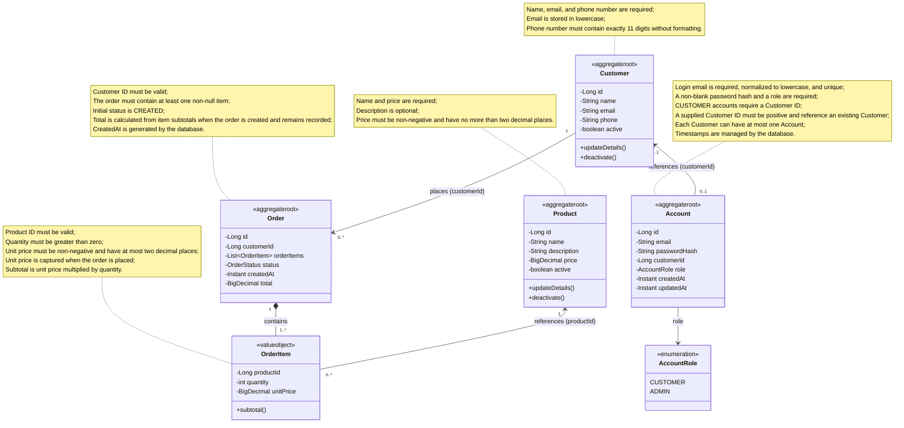

# Domain Model

## Objective

Represent the entities, behaviors, and invariants of the SetupShop domain.

## Current Scope

This diagram represents system elements to improve visualization and modeling.

Account domain and persistence are implemented. Registration, password hashing,
authentication, and authorization remain planned. The optional Customer link in
the diagram reflects the current mapping; `CUSTOMER` accounts always require
that link. Administrator creation and Customer linkage rules remain open.

The adopted hashing design uses Argon2id with automatic salt and a secret
pepper. Hashing and verification will happen outside Account. The pepper is
kept outside the database and is not an Account field. The encoding format and
secret lifecycle remain to be defined; see the
[password hashing decision](../decisions.md#password-hashing-with-argon2id-and-pepper-planned).
