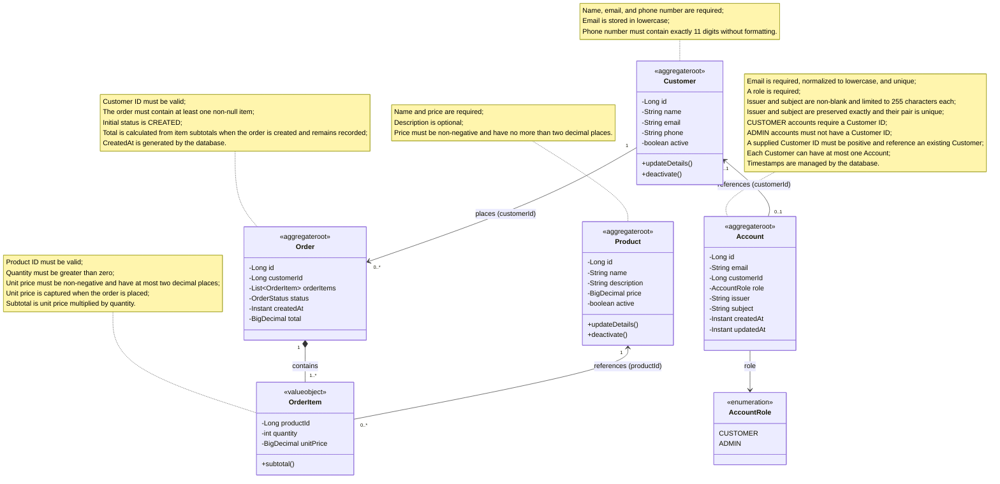

# Domain Model

## Objective

Represent the entities, behaviors, and invariants of the SetupShop domain.

## Current Scope

This diagram represents system elements to improve visualization and modeling.

Account domain, persistence, lookup by issuer and subject, and JWT
authentication are implemented.
Registration, identity-to-Account linkage, and role/ownership authorization
remain planned. The optional Customer link in
the diagram reflects the current mapping; `CUSTOMER` accounts always require
that link. ADMIN Accounts must have no Customer link; this is enforced in the
domain and database through V8.
The controlled administrator provisioning process remains open.

Account remains separate from Customer: Account represents access and local
roles; Customer represents a purchasing profile. Visitors can browse product
listing and detail without login. Comparison requires no login but has no
dedicated endpoint. Purchases will require Google
authentication and completed local onboarding, creating Customer first and
Account second in one database transaction. Individual ADMIN Accounts are
dedicated to store management and cannot purchase. Personal purchases use a
separate CUSTOMER Account and a different Google identity under the current
single-role, Google-only model. Public onboarding will always assign CUSTOMER.
These target rules do not add anonymous purchasing or change current endpoint
permissions. Role-based endpoint enforcement remains pending. Rejecting ADMIN
Customer links is implemented through domain validation and applied V8.

The diagram shows the current Account after V8: issuer and subject identify the
external identity, and the password hash field has been removed. V7 assumes an
empty accounts table and does not convert existing password accounts. The
first login version uses Google only through Auth0. The API validates access
tokens and `GET /auth/me` returns issuer and subject from the JWT. This does not
resolve a local Account or Customer. Product listing and detail GET routes are
public; all other requests require authentication. Local role and Order
ownership checks remain unimplemented.
The repository lookup returns an optional Account for an exact issuer/subject
pair and can expose its existing Customer ID to a future application flow.
It does not create that link, and the authentication endpoint does not call
the lookup yet.
The application layer now exposes GetAccountByExternalIdentityUseCase, which
returns the Account for that pair or throws AccountNotFoundException when
absent. This does not change the entity relationships in the diagram. The
use case is now called by `GET /accounts/me` using issuer and subject from the
validated JWT. The endpoint returns id, email, role, and customerId for an
existing Account or 404 when absent, while missing authentication returns 401.
It does not create or link records; onboarding remains pending.
Local password hashing and pepper
are outside this version. See the
[Google login decision](../decisions.md#google-only-login-through-auth0) and
[authentication setup](../authentication.md).
